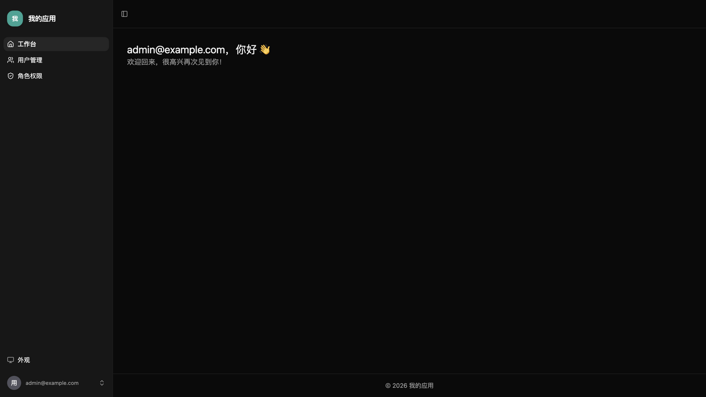
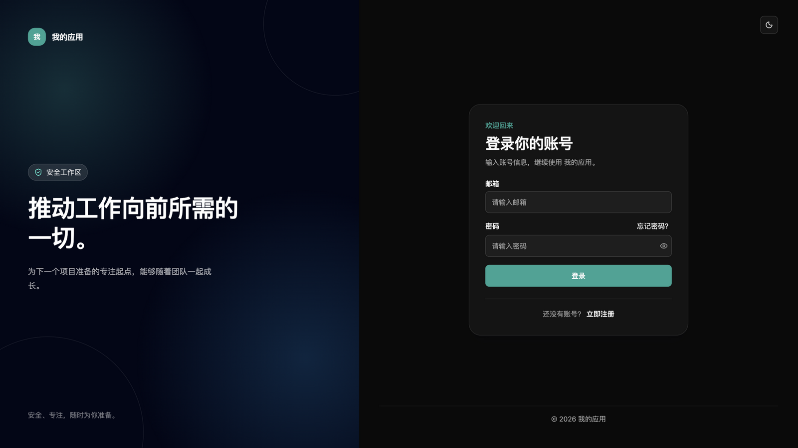
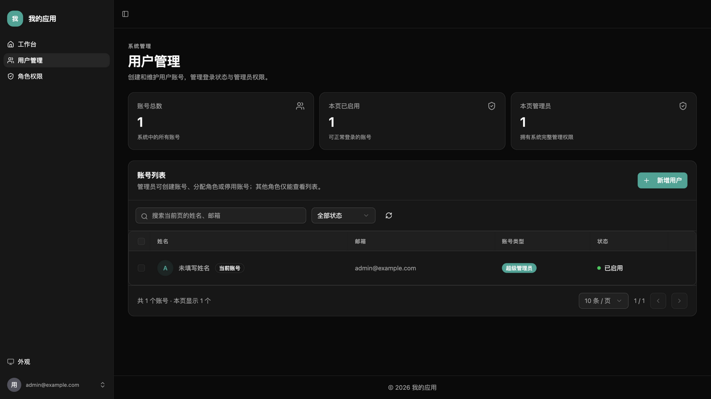

# lili-full-stack

guanlili 的个人全栈项目模板。基于 [fastapi/full-stack-fastapi-template](https://github.com/fastapi/full-stack-fastapi-template) 精简定制，面向 AI 驱动的外包项目快速交付。

| 项 | 内容 |
|------|------|
| 维护 | guanlili（李梨团队） |
| 定位 | AI 驱动的外包项目快速交付模板（Use this template，不是 Fork） |
| 基座 | [fastapi/full-stack-fastapi-template](https://github.com/fastapi/full-stack-fastapi-template) 精简定制 |
| 项目管理 | [devledger](https://github.com/guanlili/devledger)——初始化新项目时自动接入：GitHub Project 账本 + AI 会话交付自动记账 |
| 许可 | MIT（保留上游版权声明） |
| 文档导航 | [CLAUDE.md](CLAUDE.md) 开发流程 · [AGENTS.md](AGENTS.md) AI 工具通用入口 · [AI_RULES.md](AI_RULES.md) 编码与安全规范 · [PROJECT_CONTEXT.md](PROJECT_CONTEXT.md) 项目上下文 · [CHANGELOG.md](CHANGELOG.md) 模板版本 |



> **AI 助手请注意**：本仓库是模板仓库，不是具体项目。模板级开发流程见 `CLAUDE.md`，具体项目的业务背景、角色权限和数据模型见 `PROJECT_CONTEXT.md`。

---

## 技术栈

| 层级 | 技术 |
|------|------|
| 后端框架 | FastAPI + SQLModel + PostgreSQL |
| 包管理 | uv（后端）/ npm（前端）|
| 认证 | JWT + 邮件找回密码 |
| 数据库迁移 | Alembic |
| 前端框架 | React 19 + TypeScript + Vite |
| 样式 | TailwindCSS v4 + Radix UI + Lucide React |
| 数据请求 | TanStack Query + TanStack Router |
| 代码规范 | Ruff + ty（后端）/ Biome（前端）|
| 容器 | Docker Compose（nginx 内置 /api 代理，无 Traefik）|
| CI/CD | GitHub Actions：lint + 测试通过后 → server-side checkout + docker compose up |
| 项目管理 | [devledger](https://github.com/guanlili/devledger)：GitHub Project 账本，AI 会话每交付一个单元自动记 issue 与工时 |

---

## 开箱基线

克隆即得的能力——模板只保留这些，其余（文件、通用配置、导入导出、任务系统）由具体项目按需实现：

| 模块 | 内容 |
|------|------|
| 认证与会话 | JWT 登录、Access/Refresh Token 轮换、邮件找回密码（Mailcatcher 本地收信） |
| 用户管理 | 用户 CRUD、可配置角色与页面权限、自助注册（默认关闭） |
| 个人设置 | 修改资料与密码 |
| 内部审计 | 关键操作留痕 |
| 工程能力 | 前后端测试、CI（lint + 测试）、Docker 部署、备份恢复 |

历史版本的配置、文件和任务数据表保留用于升级兼容，不再提供对应接口或默认界面，不自动删除已有数据。

<details>
<summary>基线界面截图（点击展开）</summary>

**登录页（品牌区可按 --brand 定制）**


**用户管理（角色权限、审计同款风格）**


</details>

---

## 开启新项目

### 第一步：基于本模板创建新仓库

在 GitHub 上点 **Use this template → Create a new repository**（不是 Fork）。

### 第二步：克隆并初始化

```bash
git clone git@github.com:guanlili/<新项目名>.git
cd <新项目名>
bash scripts/init-project.sh "项目显示名"
```

> 在 Claude Code 里直接用 `/init-project`：AI 会一轮提问收集项目名、对接人、端口等信息并完成初始化与全部后续待办，无需手工拼参数。

脚本一次性完成：生成 `.env`（`SECRET_KEY`、数据库密码、管理员密码全部随机化）、
统一改名（`PROJECT_NAME`、前端 `APP_NAME`、页面标题）、
自动生成容器名前缀（`COMPOSE_PROJECT_NAME`，从项目名推导），并输出剩余待办清单。
本地密钥只写入权限为 `600` 的 `.env`，不会打印。
可通过 `--slug`、`--brand`、`--port`、`--registration` 指定项目标识、品牌、生产端口和注册策略，详见文末「新项目一键初始化」。

### 第三步：更新项目文档

- `PROJECT_CONTEXT.md` — 写入该项目的业务背景、角色权限、数据模型和特殊约定（AI 开发前必须填写）
- `CLAUDE.md` — 只有项目开发流程发生变化时才修改，模板级流程不要覆盖
- `AI_RULES.md` — 只有项目确实有额外的编码、安全或部署规范时才追加
- `README.md` — 按 [docs/readme-template.md](docs/readme-template.md) 骨架改写（项目信息表必填：对接人/账本/在线平台）

### 第四步：确认项目基线

基线能力见上文「开箱基线」。新项目直接根据 `PROJECT_CONTEXT.md` 开发业务模块，不需要先清理示例表、路由、测试和生成客户端。

同时确定注册方式：初始化命令默认关闭自助注册，可通过 `--registration open` 开启；生产由可选 Secret `USERS_OPEN_REGISTRATION` 控制，默认关闭。
如果项目采用“管理员建账号”模式，交付前删除注册页和登录页上的注册链接。

### 第五步：首次启动

```bash
docker compose up --build
```

| 服务 | 本地地址 |
|------|----------|
| 前端 | http://localhost:5173 |
| 后端 API 文档 | http://localhost:8000/docs |
| 邮件测试（Mailcatcher） | http://localhost:1080 |

默认管理员账号见 `.env` 中的 `FIRST_SUPERUSER` / `FIRST_SUPERUSER_PASSWORD`。

冒烟检查（全部通过 = 基线就绪）：浏览器打开 http://localhost:5173 用管理员账号登录进 dashboard；http://localhost:8000/docs 可见 API 文档。

---

## 本地开发

```bash
# 启动所有服务（自动加载 compose.override.yml）
docker compose up --build

# 启用热更新（后端 --reload + 前端 vite HMR，推荐日常开发用这个）
docker compose watch

# 停止
docker compose down

# 测试（与 CI 同口径）
cd backend && uv run bash scripts/tests-start.sh   # 后端（独立测试库 app_test）
cd frontend && npm test                             # 前端（Node 内置测试运行器）
```

本地开发时前端跑的是 vite dev server（5173 端口，支持热更新），生产镜像才是 nginx 静态托管。

---

## 新功能开发流程

开发流程见 [CLAUDE.md](CLAUDE.md)，项目上下文见 [PROJECT_CONTEXT.md](PROJECT_CONTEXT.md)，编码和安全规范见 [AI_RULES.md](AI_RULES.md)。
前端代码检查使用 `npm run lint`，需要自动格式化时使用 `npm run lint:fix`。
`npm run lint` 只检查，不会修改工作区。

交付前三件套：

1. `bash scripts/check-template.sh` — 模板文件、脚本语法、Compose 配置、示例残留与 **README 项目化**检查
2. README 截图按当前界面更新（hero 图 + 主要界面，见 [docs/readme-template.md](docs/readme-template.md)）
3. 导出验收表（装有 devledger 时）：`python3 ~/.agents/skills/devledger/scripts/export-timesheet.py --project <Project编号>`

---

## Claude Code 自定义指令

项目内置了 4 个自定义斜杠命令，在 Claude Code 中可直接使用：

| 指令 | 用途 |
|------|------|
| `/new-feature <需求>` | 根据项目上下文设计并实现功能模块 |
| `/migration <描述>` | 生成并应用 Alembic 数据库迁移 |
| `/generate-client` | 重新生成前端 API 客户端 |
| `/upgrade-deps` | 升级所有依赖包（uv + npm）|
| `/init-project` | 新项目初始化：AI 一轮提问收集信息 → 跑 init 脚本 → 填 PROJECT_CONTEXT、项目化 README、冒烟验证 |

示例：

```
/new-feature order
```

Claude Code 会按标准流程自动创建订单模块的全部后端和前端代码。

仓库还内置了团队共享的权限白名单（`.claude/settings.json`）：日常开发的高频命令
（docker compose、npm run、后端检查、git 只读、gh 查看 CI 等）已预授权，克隆即用。
涉及提交、推送、依赖锁文件和任意脚本执行的命令仍会请求确认；个人偏好写在
`.claude/settings.local.json`（已被 gitignore，不入库）。

---

## 生产部署

模板默认使用 GitHub Actions + Docker Compose 部署。完整的 Secrets、HTTPS、备份和回滚流程见 [docs/deployment.md](docs/deployment.md)。

若客户项目使用其他部署平台或发布流程，请在 `PROJECT_CONTEXT.md` 中记录差异，并以项目实际部署方案为准。

---

## 模板维护

本仓库是模板，会定期更新，现有项目不会受影响。

### 维护节奏

| 时机 | 操作 |
|------|------|
| 做项目时踩了坑 | 回来更新 `AI_RULES.md`、`CLAUDE.md` 或相关 docs |
| 每季度 | 运行 `/upgrade-deps` 升级依赖并跑完整验证 |
| 发现更好的开发模式 | 更新 `.claude/commands/` 中的指令 |

### 从模板同步改进到现有项目

模板版本见 [CHANGELOG.md](CHANGELOG.md)，同步流程见 [docs/template-upgrades.md](docs/template-upgrades.md)。按功能挑选并适配改动，保留客户业务和部署差异；不要整目录覆盖客户项目。

业务模块统一交付清单见 [docs/module-development.md](docs/module-development.md)。

---

## 项目结构

```
lili-full-stack/
├── .claude/
│   └── commands/          # Claude Code 自定义斜杠命令
├── scripts/
│   └── init-project.sh    # 新项目一键初始化（改名 + 密钥随机化）
├── .env.example           # 环境变量模板（复制为 .env 使用）
├── .env                   # 实际配置（gitignore 忽略，永不提交；生产由 Secrets 生成）
├── AGENTS.md              # AI 工具通用入口与文档优先级
├── AI_RULES.md            # AI 开发规范（技术约定）
├── CLAUDE.md              # 模板级项目结构与开发流程
├── PROJECT_CONTEXT.md     # 当前客户项目上下文（复制模板后填写）
├── docs/
│   └── deployment.md      # 生产部署、HTTPS、备份与回滚
├── compose.yml            # 生产 Docker Compose
├── compose.override.yml   # 本地开发覆盖配置
├── backend/               # FastAPI 应用、迁移和测试
└── frontend/              # React 应用、页面和生成客户端
```

---

## 与上游的主要区别

| 项目 | 上游 fastapi/full-stack-fastapi-template | 本模板 |
|------|------------------------------------------|--------|
| 反向代理 | Traefik（复杂 label 配置） | nginx proxy_pass（内置前端镜像） |
| CI/CD | staging + production 双套 | 单一 workflow：CI（lint+测试）通过后部署 |
| Playwright e2e 测试 | 包含 | 已移除 |
| Copier 模板系统 | 包含 | 已移除 |
| AI 开发规范 | 无 | AI_RULES.md + CLAUDE.md + .claude/commands/ |

---

## 设计取舍（有意不做的东西）

> 本节记录模板**刻意省略**的实践及原因。补齐它们之前请先读这里——多数"缺失"是权衡后的决定，不是疏漏。

| 不做什么 | 为什么 |
|---------|--------|
| 通用前端测试框架（vitest） | 当前使用 Node 内置测试运行器覆盖会话刷新关键逻辑；复杂组件与交互测试按具体项目引入 |
| dependabot / renovate | 小团队没精力处理持续的升级 PR 噪音。用季度 `/upgrade-deps` 集中升级 + 验证代替 |
| pre-commit 钩子 | CI 是唯一质量门槛。本地钩子对 AI 驱动的开发是摩擦（AI 每次提交都会被格式化钩子打断），且和 CI 重复 |
| staging 环境 | 单服务器多项目、快速交付定位。staging 的维护成本大于收益；重要变更靠 CI 门槛 + 部署后健康检查兜底 |
| Cookie 会话 | 当前使用 localStorage 保存 Token，Access Token 默认 15 分钟、Refresh Token 30 天并轮换；前端自动刷新。需要 Cookie 会话的项目另行设计 CSRF 与跨域策略 |
| 登录接口限流 | 不在代码层加依赖。`rate_limit` **不是 Caddy 内置模块**——官方发行版不带，需要用 `xcaddy` 自行构建含 `caddy-ratelimit` 插件的二进制（或换用云防火墙/WAF 做限流）；模板不提供也不默认包含，正式上线且暴露公网时再评估 |
| 生产环境隐藏 `/docs`、`/redoc` | API 文档公开对内网工具是便利。正式上线面向公网的项目建议关闭（`ENVIRONMENT=production` 时设 `docs_url=None`）或在 Caddy 层加 basic auth |
| Kubernetes / 多机编排 | 单服务器 docker compose 覆盖当前所有项目规模。规模到了再迁移，不预支复杂度 |

### 依赖维护说明

- 本地前端使用 Node.js 24，与 Docker 和 CI 一致；`npm test` 使用 Node 内置测试运行器，通过 `tsx` 加载生成客户端的 TypeScript 模块。
- Python 默认使用官方 PyPI，锁文件与索引配置保持一致；需要镜像时可在本机配置，避免将镜像访问限制带入模板。
- `frontend/package.json` 的 `js-yaml` override 用于修复客户端生成器间接锁定旧版本的问题。上游解除旧版本锁定后可移除，移除前运行 `npm audit` 和客户端生成验证。
- 升级客户端生成器后运行 `npm run generate-client`，同步验证表单/JSON 序列化、路径/查询参数、Token 刷新和 403 错误；生成目录保持自动生成。

### 新项目一键初始化

在新复制的仓库中执行（不要在已有生产项目中重新初始化）：

```bash
bash scripts/init-project.sh "订单管理系统" --slug order-system --brand "订单工作台" --port 8085 --registration closed
```

命令同步项目显示名、前端品牌/标题、Compose 项目标识、生产映射端口、注册策略和项目上下文名称，生成权限为 `600` 的本地 `.env`，不输出任何密码。默认关闭注册，`--registration open` 可显式打开；纯中文名称会生成带摘要的 Compose 标识，部署到同一服务器时仍应显式选择唯一 `--slug`。`--port` 控制生产 Compose 的前端映射端口，本地 Vite 仍使用 5173。

已有 `.env` 时命令直接拒绝覆盖，也不会读取已有密钥。生产配置始终使用独立的 GitHub Secrets；Logo/favicon 和业务上下文仍需按项目填写。
